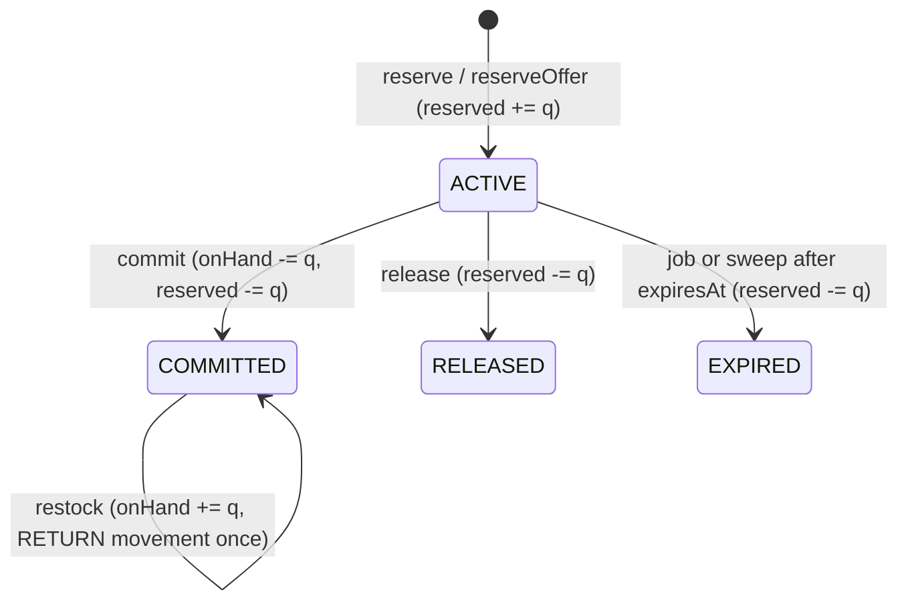

# Inventory

> Stock counters per warehouse and per seller offer, the movement ledger, time-limited reservations with a background expiry job, warehouses, and the transaction-scoped stock primitives that orders, fulfillment, procurement and returns call.

## Purpose and features

- **Staff and admins** manage warehouses, list platform inventory records, receive and adjust stock, set a reorder point, and read a record's movements and reservations. Adjustments are audited and accept an optional retry key.
- **Approved sellers** (role `SELLER`, verified email) set absolute on-hand quantities for their `SELLER`-stock offers, singly or in bulk (<=100), with optimistic concurrency, and read their movements.
- **Other modules** use `InventoryService`:
  - availability reads (products, cart, wishlist) and `getAllocatableStock` (the cart's stock check);
  - for orders: `lockOffersForKeyShare`/`lockStockPools`, then `reserve`/`reserveOffer`, then `commitMany`/`releaseMany`;
  - `receiveStockForReference`/`reverseReceiptStock` (procurement);
  - `returnCancelledStock`/`returnCancelledOfferStock` (fulfillment);
  - `receiveReturnedStock` (returns).

  Multi-record writers call `lockRecordsForWrite` first.
- **Background:** each reservation enqueues an `inventory.expire_reservation` job at its expiry time.

Two kinds of `InventoryRecord` exist ([schema.prisma:646](../../../services/commerce-api/prisma/schema.prisma#L646)):

| Kind     | Key                                          | Used by                                                                |
| -------- | -------------------------------------------- | ---------------------------------------------------------------------- |
| Platform | `(warehouseId, variantId)`, `offerId = NULL` | `PLATFORM`-stock offers of that variant, shared across all such offers |
| Seller   | `offerId` (unique), `warehouseId = NULL`     | One `SELLER`-stock offer                                               |

`available` is never stored; it is always `onHand - reserved`.

## Routes

Conventions (prefix, guards, envelope): see [../architecture.md](../architecture.md) and [../auth-and-access.md](../auth-and-access.md).

| Method | Path                                            | Access                                          | Idempotency                          | Description                                                                                                                                                                                              |
| ------ | ----------------------------------------------- | ----------------------------------------------- | ------------------------------------ | -------------------------------------------------------------------------------------------------------------------------------------------------------------------------------------------------------- |
| GET    | /api/v1/admin/inventory                         | Roles(STAFF, ADMIN)                             | n/a                                  | Platform records, optional `warehouseId`/`variantId` query (not validated) ([admin-inventory.controller.ts:25](../../../services/commerce-api/src/modules/inventory/admin-inventory.controller.ts#L25))  |
| POST   | /api/v1/admin/inventory/receive                 | Roles(STAFF, ADMIN)                             | **None**: every call adds stock      | Increment on-hand, `RECEIPT` movement ([admin-inventory.controller.ts:33](../../../services/commerce-api/src/modules/inventory/admin-inventory.controller.ts#L33))                                       |
| POST   | /api/v1/admin/inventory/adjust                  | Roles(STAFF, ADMIN)                             | Optional UUID-v4 `Idempotency-Key`, scoped to actor | Signed delta, reserved-stock floor, actor audit and original-response replay ([admin-inventory.controller.ts](../../../services/commerce-api/src/modules/inventory/admin-inventory.controller.ts)) |
| GET    | /api/v1/admin/inventory/:id/movements           | Roles(STAFF, ADMIN)                             | n/a                                  | Movements of any record, newest first ([admin-inventory.controller.ts:53](../../../services/commerce-api/src/modules/inventory/admin-inventory.controller.ts#L53))                                       |
| PATCH  | /api/v1/admin/inventory/:id/reorder-point       | Roles(STAFF, ADMIN)                             | Naturally idempotent                 | Set `reorderPoint` (platform records only) ([admin-inventory.controller.ts:60](../../../services/commerce-api/src/modules/inventory/admin-inventory.controller.ts#L60))                                  |
| GET    | /api/v1/admin/inventory/:id/reservations        | Roles(STAFF, ADMIN)                             | n/a                                  | Reservations of any record, newest first ([admin-inventory.controller.ts:68](../../../services/commerce-api/src/modules/inventory/admin-inventory.controller.ts#L68))                                    |
| GET    | /api/v1/admin/inventory/warehouses              | Roles(STAFF, ADMIN)                             | n/a                                  | All warehouses, `name asc` ([admin-warehouses.controller.ts:25](../../../services/commerce-api/src/modules/inventory/warehouses/admin-warehouses.controller.ts#L25))                                     |
| GET    | /api/v1/admin/inventory/warehouses/:id          | Roles(STAFF, ADMIN)                             | n/a                                  | One warehouse ([admin-warehouses.controller.ts:30](../../../services/commerce-api/src/modules/inventory/warehouses/admin-warehouses.controller.ts#L30))                                                  |
| POST   | /api/v1/admin/inventory/warehouses              | Roles(STAFF, ADMIN)                             | None (unique `code` -> 409)          | Create ([admin-warehouses.controller.ts:35](../../../services/commerce-api/src/modules/inventory/warehouses/admin-warehouses.controller.ts#L35))                                                         |
| PATCH  | /api/v1/admin/inventory/warehouses/:id          | Roles(STAFF, ADMIN)                             | Naturally idempotent                 | `name`, `code`, `isActive` ([admin-warehouses.controller.ts:40](../../../services/commerce-api/src/modules/inventory/warehouses/admin-warehouses.controller.ts#L40))                                     |
| DELETE | /api/v1/admin/inventory/warehouses/:id          | Roles(STAFF, ADMIN)                             | Second call returns 404              | Hard delete, 204 ([admin-warehouses.controller.ts:48](../../../services/commerce-api/src/modules/inventory/warehouses/admin-warehouses.controller.ts#L48))                                               |
| GET    | /api/v1/sellers/me/inventory                    | Roles(SELLER) + verified email                  | n/a                                  | Every own `SELLER`-stock offer with counters (zeros before the first set) ([seller-inventory.controller.ts:32](../../../services/commerce-api/src/modules/inventory/seller-inventory.controller.ts#L32)) |
| PUT    | /api/v1/sellers/me/inventory/:offerId           | Roles(SELLER) + verified email + `lockApproved` | Body `version`                       | Set absolute on-hand ([seller-inventory.controller.ts:37](../../../services/commerce-api/src/modules/inventory/seller-inventory.controller.ts#L37))                                                      |
| PATCH  | /api/v1/sellers/me/inventory/bulk               | Roles(SELLER) + verified email + `lockApproved` | Per-item `version`, all-or-nothing   | Set up to 100 offers in one transaction ([seller-inventory.controller.ts:46](../../../services/commerce-api/src/modules/inventory/seller-inventory.controller.ts#L46))                                   |
| GET    | /api/v1/sellers/me/inventory/:offerId/movements | Roles(SELLER) + verified email                  | n/a                                  | Movements of an own offer's record; `[]` if none yet ([seller-inventory.controller.ts:54](../../../services/commerce-api/src/modules/inventory/seller-inventory.controller.ts#L54))                      |

Admin record responses are `InventoryRecord & { available }`; seller responses are `SellerInventoryView` ([inventory.types.ts:5](../../../services/commerce-api/src/modules/inventory/inventory.types.ts#L5)).

## Services

| Service                                                                                                                                                                            | Responsibility                                                                        | Key public methods                                                                                                                                                                                                                                                                                                                                                                                                                                                                                                                                                                                                                                                                                                                                                                                                                                                                                                                                                                                                                                                                                                                                                                                                                                                                                                                                                                                                                                                                                                                                                                                                                                                                                                                                                                                     |
| ---------------------------------------------------------------------------------------------------------------------------------------------------------------------------------- | ------------------------------------------------------------------------------------- | ------------------------------------------------------------------------------------------------------------------------------------------------------------------------------------------------------------------------------------------------------------------------------------------------------------------------------------------------------------------------------------------------------------------------------------------------------------------------------------------------------------------------------------------------------------------------------------------------------------------------------------------------------------------------------------------------------------------------------------------------------------------------------------------------------------------------------------------------------------------------------------------------------------------------------------------------------------------------------------------------------------------------------------------------------------------------------------------------------------------------------------------------------------------------------------------------------------------------------------------------------------------------------------------------------------------------------------------------------------------------------------------------------------------------------------------------------------------------------------------------------------------------------------------------------------------------------------------------------------------------------------------------------------------------------------------------------------------------------------------------------------------------------------------------------ |
| `InventoryService` ([inventory.service.ts](../../../services/commerce-api/src/modules/inventory/inventory.service.ts))                                                             | Counters, movements, reservations. Methods taking `tx` join the caller's transaction. | `getAvailableQuantities` ([:128](../../../services/commerce-api/src/modules/inventory/inventory.service.ts#L128)), `getAvailableOfferQuantities` ([:148](../../../services/commerce-api/src/modules/inventory/inventory.service.ts#L148)), `getAllocatableStock` ([:176](../../../services/commerce-api/src/modules/inventory/inventory.service.ts#L176)), `lockInventoryRecords` ([:241](../../../services/commerce-api/src/modules/inventory/inventory.service.ts#L241)), `lockOffersForKeyShare` ([:257](../../../services/commerce-api/src/modules/inventory/inventory.service.ts#L257)), `lockStockPools` ([:276](../../../services/commerce-api/src/modules/inventory/inventory.service.ts#L276)), `lockRecordsForWrite` ([:303](../../../services/commerce-api/src/modules/inventory/inventory.service.ts#L303)), `receiveStock` ([:386](../../../services/commerce-api/src/modules/inventory/inventory.service.ts#L386)), `receiveStockForReference` ([:423](../../../services/commerce-api/src/modules/inventory/inventory.service.ts#L423)), `returnCancelledStock` ([:464](../../../services/commerce-api/src/modules/inventory/inventory.service.ts#L464)), `returnCancelledOfferStock` ([:506](../../../services/commerce-api/src/modules/inventory/inventory.service.ts#L506)), `receiveReturnedStock` ([:545](../../../services/commerce-api/src/modules/inventory/inventory.service.ts#L545)), `reverseReceiptStock` ([:594](../../../services/commerce-api/src/modules/inventory/inventory.service.ts#L594)), `adjustStock` ([:641](../../../services/commerce-api/src/modules/inventory/inventory.service.ts#L641)), `reserve` ([:818](../../../services/commerce-api/src/modules/inventory/inventory.service.ts#L818)), `reserveOffer` ([:933](../../../services/commerce-api/src/modules/inventory/inventory.service.ts#L933)), `setOfferQuantity` ([:965](../../../services/commerce-api/src/modules/inventory/inventory.service.ts#L965)), `release` ([:1030](../../../services/commerce-api/src/modules/inventory/inventory.service.ts#L1030)), `releaseMany` ([:1049](../../../services/commerce-api/src/modules/inventory/inventory.service.ts#L1049)), `expireReservation` ([:1078](../../../services/commerce-api/src/modules/inventory/inventory.service.ts#L1078)), `commit` ([:1095](../../../services/commerce-api/src/modules/inventory/inventory.service.ts#L1095)), `commitMany` ([:1108](../../../services/commerce-api/src/modules/inventory/inventory.service.ts#L1108)), `restock` ([:1157](../../../services/commerce-api/src/modules/inventory/inventory.service.ts#L1157)), `sweepExpired` ([:1189](../../../services/commerce-api/src/modules/inventory/inventory.service.ts#L1189)) |
| `SellerInventoryService` ([seller-inventory.service.ts](../../../services/commerce-api/src/modules/inventory/seller-inventory.service.ts))                                         | Seller-facing list/set/bulk/movements over `SELLER`-stock offers. Not exported.       | `list`, `set`, `updateMany` ([:61](../../../services/commerce-api/src/modules/inventory/seller-inventory.service.ts#L61)), `movements`                                                                                                                                                                                                                                                                                                                                                                                                                                                                                                                                                                                                                                                                                                                                                                                                                                                                                                                                                                                                                                                                                                                                                                                                                                                                                                                                                                                                                                                                                                                                                                                                                                                                 |
| `WarehousesService` ([warehouses.service.ts](../../../services/commerce-api/src/modules/inventory/warehouses/warehouses.service.ts))                                               | Warehouse CRUD. Exported; used by purchase orders.                                    | `findAll`, `findById`, `create`, `update`, `remove`                                                                                                                                                                                                                                                                                                                                                                                                                                                                                                                                                                                                                                                                                                                                                                                                                                                                                                                                                                                                                                                                                                                                                                                                                                                                                                                                                                                                                                                                                                                                                                                                                                                                                                                                                    |
| `InventoryExpireReservationHandler` ([inventory-expire-reservation.handler.ts](../../../services/commerce-api/src/modules/inventory/jobs/inventory-expire-reservation.handler.ts)) | Job handler for `inventory.expire_reservation`.                                       | `handle(payload)`                                                                                                                                                                                                                                                                                                                                                                                                                                                                                                                                                                                                                                                                                                                                                                                                                                                                                                                                                                                                                                                                                                                                                                                                                                                                                                                                                                                                                                                                                                                                                                                                                                                                                                                                                                                      |

## Business rules

**Counters** (conditional SQL updates or a locked adjustment transaction prevent races below each floor)

- Reserve claims with `WHERE on_hand - reserved >= q` ([inventory.service.ts:889](../../../services/commerce-api/src/modules/inventory/inventory.service.ts#L889)); commit with `on_hand >= q AND reserved >= q` ([:1136](../../../services/commerce-api/src/modules/inventory/inventory.service.ts#L1136)); release/expire with `reserved >= q`, else 409 "require reconciliation" ([:1217](../../../services/commerce-api/src/modules/inventory/inventory.service.ts#L1217)).
- Admin adjustment locks the record and requires the resulting `onHand` to remain within the PostgreSQL integer range and at least `reserved`; receipt reversal and seller set use the same reserved-stock floor. Database checks enforce `onHand >= 0`, `reserved >= 0` and `reserved <= onHand`.
- All quantity inputs must be > 0 (400) except `adjustStock` (non-zero) and seller set (>= 0).
- Platform records are created lazily by `getOrCreateRecord`; a lost create race (P2002) re-reads the winner ([inventory.service.ts:375](../../../services/commerce-api/src/modules/inventory/inventory.service.ts#L375)).

**Reservations**

- `reserve(variantId, q, opts, tx?)` ([inventory.service.ts:818](../../../services/commerce-api/src/modules/inventory/inventory.service.ts#L818)):
  - Candidates are the platform records for the variant (optionally one warehouse); none -> 404.
  - Every candidate is locked in ascending id before any is swept. Expired reservations on each are then swept **in the caller's transaction**.
  - The first record in ascending id with enough available stock is claimed. A line is never split across warehouses. Insufficient -> 409.
  - With `opts.lockedRecordIds` (from `lockStockPools`), candidates are restricted to those records. A record created after the pool lock is ignored rather than locked out of order.
- `reserveOffer(offerId, ...)`: the offer's own record, with the same lock, sweep and claim, and the same `lockedRecordIds` restriction ([inventory.service.ts:933](../../../services/commerce-api/src/modules/inventory/inventory.service.ts#L933)).
- Default TTL 15 minutes (`ttlSeconds` overrides) ([inventory.service.ts:27](../../../services/commerce-api/src/modules/inventory/inventory.service.ts#L27)). The claim, reservation row, `RESERVATION` movement and expiry job are one transaction (the caller's if `tx` is passed) ([inventory.service.ts:920](../../../services/commerce-api/src/modules/inventory/inventory.service.ts#L920)).
- `release`, `commit` and `expireReservation` lock the inventory record, then the reservation ([inventory.service.ts:1240](../../../services/commerce-api/src/modules/inventory/inventory.service.ts#L1240)). `releaseMany`/`commitMany` lock every affected record in ascending id, then every reservation in ascending id, and apply the same per-item rules ([:1261](../../../services/commerce-api/src/modules/inventory/inventory.service.ts#L1261)). Release of a non-ACTIVE reservation and commit of a COMMITTED one are no-ops; commit of RELEASED/EXPIRED -> 409 ([inventory.service.ts:1123](../../../services/commerce-api/src/modules/inventory/inventory.service.ts#L1123)).
- Expiry only acts on `ACTIVE` with `expiresAt <= now`, so an early or duplicate job does nothing ([inventory.service.ts:1078](../../../services/commerce-api/src/modules/inventory/inventory.service.ts#L1078)). `sweepExpired` and `expireReservation` join the caller's `tx` and open their own transaction only when called without one ([:1189](../../../services/commerce-api/src/modules/inventory/inventory.service.ts#L1189)).
- `getAllocatableStock(pools)` returns, per pool, each record's `onHand - reserved` plus its lapsed `ACTIVE` reservations, in ascending record id ([inventory.service.ts:176](../../../services/commerce-api/src/modules/inventory/inventory.service.ts#L176)). That is what checkout would find after its sweep. It is read-only and takes no locks; the cart's stock check uses it with `canAllocateFirstFit` ([stock-allocation.ts](../../../services/commerce-api/src/modules/inventory/stock-allocation.ts)).

**Lock order**

Every path that locks several stock rows follows the global order `users → checkout_attempts → carts → orders → offers (FOR KEY SHARE) → inventory_records (ascending id) → reservations (ascending id)`; see the [Stage 7 verification](../transactional-shopping-verification.md#lock-order).

- **Order transaction:** `lockOffersForKeyShare`, then `lockStockPools` (every record of the affected pools, ascending id), then reservations.
- **`confirmPayment` / `cancel`:** the order row, then `commitMany` / `releaseMany`.
- **Multi-record writers** call `lockRecordsForWrite`, which locks their existing records in ascending id before the first write: seller bulk update, goods-receipt posting and reversal, fulfillment cancellation restock, and return-inspection restock. A record that does not exist yet is created later and is uncontended.

**Idempotency of the reference-based helpers**

- `receiveReturnedStock` and `restock` skip if a `RETURN` movement with the same reference already exists ([inventory.service.ts:334](../../../services/commerce-api/src/modules/inventory/inventory.service.ts#L334), [:733](../../../services/commerce-api/src/modules/inventory/inventory.service.ts#L733)). `receiveStockForReference`, `reverseReceiptStock`, `returnCancelledStock` and `returnCancelledOfferStock` rely on their callers for idempotency.

**Seller inventory**

- Duplicate offer ids in one request -> 400 before any transaction ([seller-inventory.service.ts:66](../../../services/commerce-api/src/modules/inventory/seller-inventory.service.ts#L66)).
- Everything runs inside one transaction ([seller-inventory.service.ts:61](../../../services/commerce-api/src/modules/inventory/seller-inventory.service.ts#L61)):
  1. `lockApproved`; every offer must be the seller's (404) and `stockSource=SELLER` (400).
  2. `FOR KEY SHARE` on the offers, then every existing record locked in ascending id.
  3. Updates run in record-id order; offers with no record yet come last. The response stays in `offerId` order.
- `setOfferQuantity`: missing record is created only when `version === 0`; the update is `updateMany where { id, version, reserved <= quantity }` with `version + 1`; mismatch -> 409; the movement stores the **signed** delta with reference `seller_user:<userId>` ([inventory.service.ts:965](../../../services/commerce-api/src/modules/inventory/inventory.service.ts#L965)).
- Reads use `SellersService.mine`, so suspended sellers can still read.

**Warehouses**

- `code` `^[A-Z0-9_-]+$`, unique (P2002 -> 409) ([create-warehouse.dto.ts:9](../../../services/commerce-api/src/modules/inventory/warehouses/dto/create-warehouse.dto.ts#L9)). `isActive` is only settable on update.
- Delete locks the warehouse and rejects any inventory record with 409. Other purchasing, fulfillment and return references are restrictive and also map to 409. Inventory movements and reservations cannot be erased through an inventory-record cascade.

## Data

| Model               | Access                                                                                                                                                                                                                |
| ------------------- | --------------------------------------------------------------------------------------------------------------------------------------------------------------------------------------------------------------------- |
| `InventoryRecord`   | Read/write, raw SQL for counters; `version` only bumped by seller set ([schema.prisma:646](../../../services/commerce-api/prisma/schema.prisma#L646))                                                                 |
| `InventoryMovement` | Append-only ledger: `RECEIPT`, `ADJUSTMENT`, `RESERVATION`, `RELEASE`, `COMMITMENT`, `RETURN`; `referenceType/referenceId` without FK ([schema.prisma:673](../../../services/commerce-api/prisma/schema.prisma#L673)) |
| `StockAdjustmentReceipt` | Actor-scoped optional retry key, canonical request hash and immutable original response for admin adjustments |
| `Reservation`       | Create, status updates, row locks ([schema.prisma:690](../../../services/commerce-api/prisma/schema.prisma#L690))                                                                                                     |
| `Warehouse`         | Read/write ([schema.prisma:626](../../../services/commerce-api/prisma/schema.prisma#L626))                                                                                                                            |
| `BackgroundJob`     | Enqueue via `BackgroundJobsService`                                                                                                                                                                                   |

## Dependencies

- Imports `WarehousesModule`, `OffersModule` (`OfferReadService`), `SellersModule` (`mine`, `lockApproved`) ([inventory.module.ts:13](../../../services/commerce-api/src/modules/inventory/inventory.module.ts#L13)); `BackgroundJobsService` from infrastructure.
- Exports `InventoryService` and the job handler ([inventory.module.ts:20](../../../services/commerce-api/src/modules/inventory/inventory.module.ts#L20)); consumed by products, cart, wishlist, orders, fulfillment, procurement, returns and `WorkersModule`.

## Jobs and events

- `inventory.expire_reservation`, payload `{ reservationId }`, `runAt = expiresAt`, default 5 attempts ([inventory.service.ts:920](../../../services/commerce-api/src/modules/inventory/inventory.service.ts#L920)). The handler throws on a malformed payload so it dead-letters ([inventory-expire-reservation.handler.ts:21](../../../services/commerce-api/src/modules/inventory/jobs/inventory-expire-reservation.handler.ts#L21)). See [../background-processing.md](../background-processing.md#job-queue).
- Expired reservations are also swept inline, in the caller's transaction, before each reserve ([inventory.service.ts:1189](../../../services/commerce-api/src/modules/inventory/inventory.service.ts#L1189)).
- No outbox topics and no audit rows.

## Configuration

None. The 15-minute TTL is a constant.

## Tests

- [inventory.service.spec.ts](../../../services/commerce-api/src/modules/inventory/inventory.service.spec.ts): availability sums and batching, seller/platform separation, `setOfferQuantity` concurrency and signed movement, expiry deadline, restock idempotency, receive/adjust validation and floor, reserve not-found/insufficient/sweep/job enqueue, release/expire/commit idempotency and counters, `returnCancelledStock`, `receiveStockForReference`, `reverseReceiptStock`.
- [seller-inventory.service.spec.ts](../../../services/commerce-api/src/modules/inventory/seller-inventory.service.spec.ts): zero defaults, other seller's offer, duplicate ids, single transaction with record-id lock order.
- [stock-allocation.spec.ts](../../../services/commerce-api/src/modules/inventory/stock-allocation.spec.ts): first-fit allocation without splitting, demand order and the `integer` bound.
- [test/inventory-locking.integration-spec.ts](../../../services/commerce-api/test/inventory-locking.integration-spec.ts) (real PostgreSQL), with results in the [Stage 7 verification](../transactional-shopping-verification.md#verification):
  - an in-transaction sweep with two lines on one variant;
  - expiry, cancel and confirm racing checkout;
  - reversed line orders across records;
  - no oversell under N concurrent checkouts;
  - idempotent release and commit;
  - a record created after the pool lock.
- [inventory-expire-reservation.handler.spec.ts](../../../services/commerce-api/src/modules/inventory/jobs/inventory-expire-reservation.handler.spec.ts): job type and payload parsing.
- [warehouses.service.spec.ts](../../../services/commerce-api/src/modules/inventory/warehouses/warehouses.service.spec.ts): P2002 -> 409, locked deletion, stock/reference conflicts and unknown targets.
- [test/inventory.e2e-spec.ts](../../../services/commerce-api/test/inventory.e2e-spec.ts): receive/reserve/release with accurate availability, over-reserve rejected, expiry through the job worker, commit.
- [test/inventory-adjustments.integration-spec.ts](../../../services/commerce-api/test/inventory-adjustments.integration-spec.ts) (real PostgreSQL): reserved floor, signed history, actor audit, identical/conflicting retries, concurrent requests, keyless calls, integer overflow and transactional rollback.

## Known gaps

- `reserve` does not skip inactive warehouses ([inventory.service.ts:818](../../../services/commerce-api/src/modules/inventory/inventory.service.ts#L818)).
- One deadlock pair remains with product hard delete. A stock write that creates a new platform record (goods receipt, return restock or fulfillment cancellation into a warehouse with no record yet) takes `FOR KEY SHARE` on the variant only at insert time. Variants are not pre-locked, so this can deadlock against a product hard delete, which locks variants, then offers, then records. PostgreSQL aborts one side.
- `getAllocatableStock` is an unlocked snapshot. A cart accepted against it can still be refused by checkout's locked allocation.
- Historical `ADJUSTMENT` rows written before migration `20260930170000_inventory_adjustment_safety` are not rewritten, so an old positive quantity may represent either direction. New admin adjustments and receipt reversals are signed.
- Admin receive still has no `Idempotency-Key` or actor audit; a retried receive request can double-count stock.
- `receiveStock` creates the record outside its transaction, and receive/adjust do not check that the warehouse or variant is active; a bad id surfaces as an unmapped P2003 (500).
- `GET /admin/inventory` passes `warehouseId`/`variantId` unvalidated into Prisma; a non-UUID gives 500 ([admin-inventory.controller.ts:27](../../../services/commerce-api/src/modules/inventory/admin-inventory.controller.ts#L27)).
- `restock` and `getAvailableQuantity` have no callers outside tests ([inventory.service.ts:723](../../../services/commerce-api/src/modules/inventory/inventory.service.ts#L723), [:45](../../../services/commerce-api/src/modules/inventory/inventory.service.ts#L45)).
- Platform `InventoryRecord.version` is never incremented by admin paths, so it is not a usable concurrency token there.
- `reorderPoint` is stored but nothing reports or alerts on low stock.
