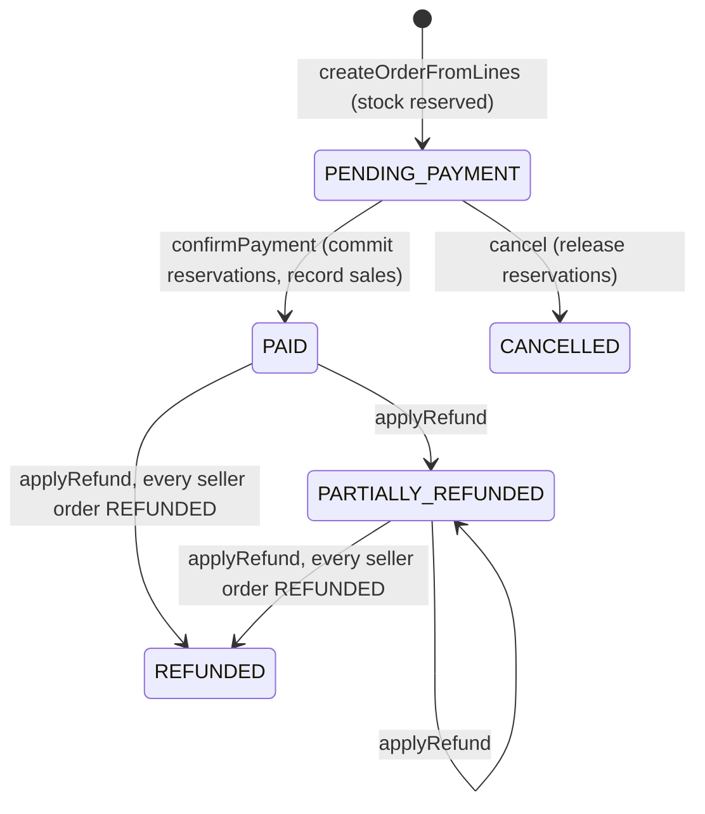

# Orders

> Order creation from cart lines or a single offer (split into seller orders and shipping groups, with stock reserved in the same transaction), checkout cost quotes, the order payment/refund state machine, and customer, staff and seller read views.

## Purpose and features

- **Checkout** (see [checkout.md](checkout.md)) asks `OrdersService` to build an order from the cart, from a partial cart selection, or from one offer ("buy now"), and to quote the same breakdown without creating anything.
- **Payments** drive the state machine: `confirmPayment` (reservations committed, sale booked, fulfillment job enqueued), `cancel` (reservations released) and `applyRefund` per seller order. See [payments.md](payments.md).
- **Customers** list and read their own orders, with their payment status and a derived fulfillment summary.
- **Staff/admins** list all orders (paginated) and read any order.
- **Approved sellers** list and read their own seller orders with fulfillment, shipment and return summaries; the delivery address stays coarse until they accept their own SELLER-mode fulfillment order.

## Routes

Cancellation also exposes owner `POST /api/v1/orders/:id/cancel` and staff/admin `POST /api/v1/admin/orders/:id/cancel` through [cancellation controllers](../../../services/commerce-api/src/modules/orders/cancellation/order-cancellation.controller.ts). These cancel pending orders; paid orders follow fulfillment/refund flows. `test/orders.integration-spec.ts` contains database scenarios, whose current execution status is in the [baseline ledger](../baseline-verification.md).

Conventions (prefix, guards, envelope, pagination): see [../architecture.md](../architecture.md), [../auth-and-access.md](../auth-and-access.md). All routes are reads; the write paths are reached only through checkout, payments and returns.

| Method | Path                          | Access                                             | Idempotency | Description                                                                                                                                                                                                             |
| ------ | ----------------------------- | -------------------------------------------------- | ----------- | ----------------------------------------------------------------------------------------------------------------------------------------------------------------------------------------------------------------------- |
| GET    | /api/v1/orders                | Authenticated                                      | n/a         | Own orders, newest first, unpaginated ([orders.controller.ts:11](../../../services/commerce-api/src/modules/orders/orders.controller.ts#L11))                                                                           |
| GET    | /api/v1/orders/:id            | Authenticated (owner, else 404)                    | n/a         | Own order with payment + fulfillment summary ([orders.controller.ts:16](../../../services/commerce-api/src/modules/orders/orders.controller.ts#L16))                                                                    |
| GET    | /api/v1/admin/orders          | Roles(STAFF, ADMIN)                                | n/a         | All orders, `page`/`limit`, `status` ([admin-orders.controller.ts:13](../../../services/commerce-api/src/modules/orders/admin-orders.controller.ts#L13))                                                                |
| GET    | /api/v1/admin/orders/:id      | Roles(STAFF, ADMIN)                                | n/a         | Any order, no fulfillment summary ([admin-orders.controller.ts:21](../../../services/commerce-api/src/modules/orders/admin-orders.controller.ts#L21))                                                                   |
| GET    | /api/v1/sellers/me/orders     | Authenticated + verified email + `requireApproved` | n/a         | Own seller orders; filters `status`, `fulfillmentStatus`, `fulfillmentMode`, `dateFrom`, `dateTo` ([seller-orders.controller.ts:19](../../../services/commerce-api/src/modules/orders/seller-orders.controller.ts#L19)) |
| GET    | /api/v1/sellers/me/orders/:id | Authenticated + verified email + `requireApproved` | n/a         | Seller order detail ([seller-orders.controller.ts:27](../../../services/commerce-api/src/modules/orders/seller-orders.controller.ts#L27))                                                                               |

Quote routes (`POST /api/v1/checkout/quote`, `/checkout/buy-now/quote`) live in the checkout controller.

## Services

| Service                                                                                                                          | Responsibility                                                                                                                                                                                                                                                                                                                                          |
| -------------------------------------------------------------------------------------------------------------------------------- | ------------------------------------------------------------------------------------------------------------------------------------------------------------------------------------------------------------------------------------------------------------------------------------------------------------------------------------------------------- |
| `OrdersService` ([orders.service.ts](../../../services/commerce-api/src/modules/orders/orders.service.ts))                       | Create (`createFromCart`, `createFromOffer`, both optionally fenced by a checkout attempt), `findForCheckout` (the order a resumed attempt continues), quote (`quoteFromCart`, `quoteFromOffer`), state machine (`lockForPayment`, `confirmPayment`, `cancel`, `applyRefund`, `getSellerOrderForPayment`), reads (`listOwn`, `findOwn`, `findAny`, `listAll`). Only export of the module. |
| `SellerOrdersService` ([seller-orders.service.ts](../../../services/commerce-api/src/modules/orders/seller-orders.service.ts))   | Seller-scoped list/detail projections.                                                                                                                                                                                                                                                                                                                  |
| `projectDestination` ([destination-summary.ts:28](../../../services/commerce-api/src/modules/orders/destination-summary.ts#L28)) | Full address only for a SELLER-mode group with `acceptedAt`; otherwise `{city, region, country}`.                                                                                                                                                                                                                                                       |

## Business rules

`Order` and each `SellerOrder` share `OrderStatus`. Payment and cancel move all seller orders in lockstep; refunds move one seller order and derive the parent.

**Line selection and quotes**

- Cart source ([orders.service.ts:194](../../../services/commerce-api/src/modules/orders/orders.service.ts#L194)): the user's cart view in the requested currency; `itemIds` restricts to those lines. Any id not in the cart -> 409; empty selection -> 409 `No items selected` / `Cart is empty`; any unavailable line -> 409. Unavailable lines outside the selection are ignored.
- The cart source then takes the checkout snapshot of the selected lines (`CartService.getCheckoutSnapshot`): `{id, offerId, quantity, revision}`. A line that differs from the priced view -> 409 `Cart changed; review your cart and check out again`. Lines are reserved in snapshot order, cart line `(createdAt, id)`, which is the order the cart's own stock check allocates in.
- Offer source: `CartService.previewOfferLine(offerId, quantity, currency)`; unavailable -> 409 ([orders.service.ts:268](../../../services/commerce-api/src/modules/orders/orders.service.ts#L268)). The cart is never read.
- Quotes run exactly the same selection/validation, then `quoteLines`: address must be the user's (`AddressesService.findOne`), lines grouped by seller, each group priced by `ShippingService.quoteSellerGroups` against the destination country ([orders.service.ts:312](../../../services/commerce-api/src/modules/orders/orders.service.ts#L312), [:367](../../../services/commerce-api/src/modules/orders/orders.service.ts#L367)). Nothing is written.
- Grouping re-reads offers and 409s if an offer is missing or its `sellerId` differs from the cart line's ([orders.service.ts:1055](../../../services/commerce-api/src/modules/orders/orders.service.ts#L1055)). `sellerId: null` is the first-party group; groups are processed sorted by seller id ([:432](../../../services/commerce-api/src/modules/orders/orders.service.ts#L432)).
- `total = subtotal + shippingAmount`, subtotal = sum of cart `lineTotal`s.

**Order creation** ([orders.service.ts:468](../../../services/commerce-api/src/modules/orders/orders.service.ts#L468))

One transaction, following the [global lock order](../transactional-shopping-verification.md#lock-order):

1. `Order` (`PENDING_PAYMENT`, address snapshot, optional `idempotencyKey`, and for cart checkouts the internal `checkoutCartSnapshot`).
2. For a keyed checkout, link the attempt: a conditional update on the attempt's owner token, `IN_PROGRESS` and no order linked yet, which also sets stage `ORDER_CREATED` and renews the lease. No match -> `CheckoutAttemptSupersededError` (409 `CHECKOUT_IN_PROGRESS`) and the whole order rolls back.
3. For a cart checkout, `CartService.lockAndVerifyCheckoutSnapshot` locks the cart row and rejects any changed line with 409.
4. `InventoryService.lockOffersForKeyShare`, then `lockStockPools`, which locks every inventory record of the affected pools in ascending id.
5. Per seller group: `LedgerService.ensureCurrency` (marketplace sellers only), a `SellerOrder`, and one `ShippingGroup` per quoted group (rate, carrier, method, quote id/expiry, delivery estimate) with its `OrderItem`s nested.
6. Every item is reserved in the canonical line order: `reserveOffer` for `stockSource=SELLER`, else `reserve(variantId)`. The holder is `order_item:<id>`, allocation is restricted to the records locked in step 4, and `reservationId` is stored on the item ([:638](../../../services/commerce-api/src/modules/orders/orders.service.ts#L638)).
7. For a cart checkout, enqueue `cart.cleanup_items {userId, orderId}` at +60 s with `maxAttempts` 20 ([:711](../../../services/commerce-api/src/modules/orders/orders.service.ts#L711)).

Any failure rolls back the whole order, including a failed cleanup enqueue. `(userId, idempotencyKey)` is unique. A P2002 on it gives `CheckoutAttemptSupersededError` under an attempt fence, and otherwise 409 "A checkout with this idempotency key is already in progress" ([:689](../../../services/commerce-api/src/modules/orders/orders.service.ts#L689)).

**State transitions**

- `lockForPayment` = `SELECT ... FROM orders ... FOR UPDATE` ([orders.service.ts:704](../../../services/commerce-api/src/modules/orders/orders.service.ts#L704)); every transition takes it first, and so does the Payment insert ([payments.md](payments.md#business-rules)).
- `confirmPayment` ([:727](../../../services/commerce-api/src/modules/orders/orders.service.ts#L727)) runs entirely in the caller's tx:
  - No-op if already PAID/PARTIALLY_REFUNDED/REFUNDED; 409 unless `PENDING_PAYMENT`.
  - Commits every reservation with `InventoryService.commitMany` (records, then reservations, each ascending), sets all seller orders PAID, and calls `LedgerService.recordSale` per seller order (sorted by seller id).
  - Sets the order PAID, enqueues `fulfillment.provision` and writes outbox `order.paid`.
  - For an order with a cart snapshot, enqueues `cart.cleanup_items` again, so a payment that settles later still cleans the cart.
- `cancel` ([:863](../../../services/commerce-api/src/modules/orders/orders.service.ts#L863)): no-op if CANCELLED; 409 "A paid order must be refunded, not cancelled" unless `PENDING_PAYMENT`; releases every reservation with `releaseMany`, cancels all seller orders.
- `applyRefund` ([:805](../../../services/commerce-api/src/modules/orders/orders.service.ts#L805)): seller order must be PAID/PARTIALLY_REFUNDED and `amount <= total - refundedAmount`; sets `REFUNDED` when fully refunded else `PARTIALLY_REFUNDED`; parent becomes `REFUNDED` only when every seller order is. Refunds never restock; restocking happens only through returns disposition.

**Reads**

- `checkoutCartSnapshot` is persistence detail: every read that leaves the service passes `omit: ORDER_OMIT`, and `OrderWithItems` excludes the field ([orders.service.ts:69](../../../services/commerce-api/src/modules/orders/orders.service.ts#L69)). Customer, admin and seller APIs never return it.
- Customer reads include `payment {id, status, failureReason}` ([orders.service.ts:126](../../../services/commerce-api/src/modules/orders/orders.service.ts#L126)), `fulfillmentSummary` (from `deriveCustomerFulfillmentSummary`) and `packedAt` = latest completed PACK work item, only when the summary is PACKED or (partially) DISPATCHED ([:1012](../../../services/commerce-api/src/modules/orders/orders.service.ts#L1012)).
- Admin list is ordered `createdAt desc, id desc` ([orders.service.ts:978](../../../services/commerce-api/src/modules/orders/orders.service.ts#L978)).
- Seller list ([seller-orders.service.ts:74](../../../services/commerce-api/src/modules/orders/seller-orders.service.ts#L74)): scoped to `sellerId`; `fulfillmentStatus` = some fulfillment order at that status; `fulfillmentMode` = some shipping group of that mode; date range on `createdAt`. Each row gets fulfillment-order summaries (`awaitingAcceptance`), shipment counts by status, and return-item counts by parent `ReturnRequest.status` ([:268](../../../services/commerce-api/src/modules/orders/seller-orders.service.ts#L268)).
- Seller detail ([seller-orders.service.ts:127](../../../services/commerce-api/src/modules/orders/seller-orders.service.ts#L127)): other seller's order -> 404. Destination is full only when the group is SELLER-mode and **every** fulfillment order on it is accepted ([:195](../../../services/commerce-api/src/modules/orders/seller-orders.service.ts#L195)). Fulfillment-order `id` is null for PLATFORM-mode groups ([:207](../../../services/commerce-api/src/modules/orders/seller-orders.service.ts#L207)). Includes line quantities, fulfillment events, shipments with tracking, and projected return items.

## Data

| Model                                                               | Access                                                           |
| ------------------------------------------------------------------- | ---------------------------------------------------------------- |
| `Order`                                                             | create (with `checkoutCartSnapshot` for cart checkouts), update (status), lock `FOR UPDATE`, read (snapshot omitted) |
| `CheckoutAttempt`                                                   | fenced link update inside the order transaction                  |
| `Offer`                                                             | `FOR KEY SHARE` before inventory records are locked              |
| `SellerOrder`                                                       | create, update (status, refundedAmount), read                    |
| `ShippingGroup`, `OrderItem`                                        | create (nested), update `reservationId`, read                    |
| `Payment`                                                           | read (customer select)                                           |
| `FulfillmentOrder`, `FulfillmentWorkItem`, `Shipment`, `ReturnItem` | read (summaries, seller views)                                   |
| `Reservation`, `InventoryRecord`                                    | via `InventoryService` (`lockStockPools`, reserve, `commitMany`, `releaseMany`) |
| `CartItem`, `Cart`                                                  | via `CartService` (snapshot read, cart lock and verification)    |
| `LedgerEntry`, `SellerBalance`                                      | via `LedgerService` (`ensureCurrency`, `recordSale`)             |
| `BackgroundJob`, `OutboxEvent`                                      | via `BackgroundJobsService`, `OutboxService`                     |

## Dependencies

- Imports `OffersModule`, `CartModule`, `InventoryModule`, `AddressesModule`, `SellersModule`, `ShippingModule`, `FinancialsModule` ([orders.module.ts:17](../../../services/commerce-api/src/modules/orders/orders.module.ts#L17)).
- Callers: checkout (create/quote/`findForCheckout`/cancel/findOwn), payments (`lockForPayment`, `confirmPayment`, `cancel`, `applyRefund`, `getSellerOrderForPayment`).
- Imports `CheckoutAttemptSupersededError` and `CHECKOUT_ATTEMPT_LEASE_MS` from `checkout/checkout-attempt.errors.ts`, which has no orders dependency, and `CART_CLEANUP_JOB_TYPE` from the cart module.

## Jobs and events

- Enqueues `fulfillment.provision {orderId}` and records outbox `order.paid` in `confirmPayment` ([orders.service.ts:767](../../../services/commerce-api/src/modules/orders/orders.service.ts#L767)). See [../background-processing.md](../background-processing.md).
- Enqueues `cart.cleanup_items {userId, orderId}` (+60 s, `maxAttempts` 20) in the order transaction of every cart checkout, and again in `confirmPayment` when the order has a cart snapshot ([orders.service.ts:711](../../../services/commerce-api/src/modules/orders/orders.service.ts#L711)). See [cart.md](cart.md#jobs-and-events).
- Reservation expiry jobs are enqueued by `InventoryService` when stock is reserved.

## Configuration

None specific to this module (commission/hold settings belong to financials; shipping rates to shipping).

## Tests

- [orders.service.spec.ts](../../../services/commerce-api/src/modules/orders/orders.service.spec.ts): empty/unavailable/partial selection, reservation per line, seller split, atomic rollback, buy-now without cart, quotes match checkout, `confirmPayment` effects, `applyRefund` bounds and no restock, `cancel`, `findOwn` ownership.
- [seller-orders.service.spec.ts](../../../services/commerce-api/src/modules/orders/seller-orders.service.spec.ts): cross-seller 404, destination reveal/redaction (SELLER vs PLATFORM), own return items only, list scoping and filters.
- [checkout.e2e-spec.ts](../../../services/commerce-api/test/checkout.e2e-spec.ts): reserve on checkout, confirm on webhook, per-seller split.
- [test/inventory-locking.integration-spec.ts](../../../services/commerce-api/test/inventory-locking.integration-spec.ts), [test/cart-concurrency.integration-spec.ts](../../../services/commerce-api/test/cart-concurrency.integration-spec.ts) and [test/checkout-idempotency.integration-spec.ts](../../../services/commerce-api/test/checkout-idempotency.integration-spec.ts) (real PostgreSQL): lock ordering against cancel, confirm and expiry; snapshot revalidation; attempt fencing. See the [Stage 7 verification](../transactional-shopping-verification.md#verification).
- No tests for the admin controller or `listAll`.

## Known gaps

- Owner `POST /api/v1/orders/:id/cancel` and admin cancellation are implemented in `OrderCancellationController`. The reconciliation worker can cancel eligible expired referenced unified payments. Neither establishes safe late-success recovery after stock expiry; see [current gaps](../known-gaps.md).
- `GET /admin/orders?status=...` is probably rejected with 400: `status` is read with a separate `@Query('status')`, but the `@Query()` `PaginationQueryDto` is validated with `forbidNonWhitelisted`. There is also no enum validation of `status` ([admin-orders.controller.ts:15](../../../services/commerce-api/src/modules/orders/admin-orders.controller.ts#L15)).
- `GET /orders` is unpaginated ([orders.service.ts:894](../../../services/commerce-api/src/modules/orders/orders.service.ts#L894)).
- `unitAmount` falls back to `0` when a line has no `unitPrice` ([orders.service.ts:617](../../../services/commerce-api/src/modules/orders/orders.service.ts#L617)). It relies on `isAvailable` guaranteeing a price.
- A partial refund of one seller order marks the parent `PARTIALLY_REFUNDED` even if other seller orders are untouched ([orders.service.ts:857](../../../services/commerce-api/src/modules/orders/orders.service.ts#L857)).
- A `PENDING_PAYMENT` order whose checkout failed before a payment row existed holds its stock until a same-key retry resumes it, or until `orders.expire_unpaid` cancels it. That job is enqueued in every order transaction and runs at the reservation TTL plus 60 s. Customer and staff cancellation re-reads the payment under the order lock and answers a retryable 409 if one appeared meanwhile. See [Stage 7: unpaid orders](../transactional-shopping-verification.md#unpaid-orders-cancellation-and-resumption).
- Admin order reads have no audit trail and no DB re-check of the staff role.
- Seller return summary counts return **items**, not return requests ([seller-orders.service.ts:286](../../../services/commerce-api/src/modules/orders/seller-orders.service.ts#L286)).
- Seller-order status only mirrors payment/refund; seller-side fulfillment progress lives in the fulfillment module.
